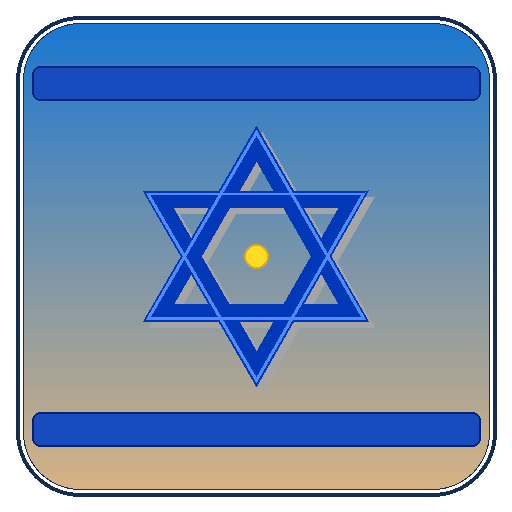

# Israel-Simulator

<p align="center">
  
</p>

<p align="center">
  <strong>An open-world Minecraft Java Edition expansion exploring Israeli environments, living cities, cultural traditions, dynamic economies, and chaotic sandbox encounters.</strong>
</p>

<p align="center">
  <a href="https://neoforged.net/"></a>
  <a href="https://minecraft.net/"></a>
  <a href="https://adoptium.net/"></a>
  <a href="LICENSE"></a>
  <a href="https://github.com/TCDev10/Israel-Simulator/actions/workflows/build.yml"></a>
  <a href="https://github.com/TCDev10/Israel-Simulator/releases"></a>
</p>

---

> 📖 **Official Documentation & Wiki:** Explore the complete **[GitHub Wiki (wiki/)](wiki/Home.md)** for in-depth guides on all 19 structures, items, bosses, kosher rules, and economies.

## Table of Contents

- [Overview](#overview)
- [Official Wiki](wiki/Home.md)
- [Key Features](#key-features)
  - [Deterministic Biomes & World Generation](#-deterministic-biomes--world-generation)
  - [19 Procedural Real Structures](#-19-procedural-real-structures)
  - [Dynamic Cities & Tel Aviv District System](#-dynamic-cities--tel-aviv-district-system)
  - [Living Cultural & Religious Mechanics](#-living-cultural--religious-mechanics)
  - [Currency, Economy & Food](#-currency-economy--food)
  - [Endgame & Sandbox Encounters](#-endgame--sandbox-encounters)
- [Installation Guide](#installation-guide)
  - [Client (Singleplayer & Multiplayer)](#client-singleplayer--multiplayer)
  - [Dedicated Server](#dedicated-server)
- [Building from Source (Developer Guide)](#building-from-source-developer-guide)
  - [Prerequisites](#prerequisites)
  - [Compiling the Mod JAR](#compiling-the-mod-jar)
  - [Running Development Client / Server](#running-development-client--server)
  - [Running the Test Suite](#running-the-test-suite)
- [Project Architecture](#project-architecture)
- [Contributing](#contributing)
- [Localization](#localization)
- [License & Credits](#license--credits)

---

## Overview

**Israel-Simulator** is a sandbox mod built for **NeoForge 26.2** (targeting **Minecraft 26.2** on **Java 25**). Rather than being a linear adventure map or a scripted tour, the mod proceduralizes the landscape of Israel into Minecraft's native world generation.

It combines two core experiences:
1. **Authentic Cultural Simulation**: Walk the limestone alleys of Jerusalem's Old City, pray at the Western Wall with a Kippah, wear a Talit and Tefillin, light the Hanukkah Menorah, sample street food (falafel, shakshuka, sabich, hummus), and pay with Shekels or a Rav-Kav card.
2. **Chaotic Sandbox Gameplay**: Discover ancient desert sanctuaries holding the mythic *Rabbi's Crown*, venture into tech startups in Tel Aviv, battle the satirical *Bibi* boss and his security guards, and play the legendary *Hava Nagila* music disc.

Every mechanic is built from the ground up to be **authoritative on the server**, ensuring fair multiplayer environments without client-side exploit vectors.

---

## Key Features

### 🌍 Deterministic Biomes & World Generation

The mod organizes Israeli biomes into an intuitive West-to-East geographic strip at depth `0.0`:
* **Mediterranean Coast**: Sandy shorelines, warm waters, palm flora, and maritime climate.
* **Urban Area**: Modern metropolitan terrain, paved transit grids, and bustling plazas.
* **Israeli Agriculture**: Fertile terraced fields, olive groves, and vineyards producing custom grapevine crops.
* **Jerusalem Highlands**: Rugged limestone hills, ancient pathways, and Jerusalem Stone bedrock.
* **Judean Desert**: Arid sandstone valleys, canyons, oasis pockets, and harsh survival conditions.
* **Dead Sea**: Deep salt-crusted depression with salt blocks, mineral water, and extreme elevation drops bordering Jerusalem and the desert.

### 🏛️ 19 Procedural Real Structures

All 19 registered structures are real builds with furnished interiors and chest/barrel loot tables, each locked to one biome. Most are multi-piece jigsaws that follow the terrain (streets bend with the ground, buildings sit on buried footings); the others are single hand-built pieces, some with several variants:

| Structure | Biome | Size / layout | Key Highlights |
| :--- | :--- | :--- | :--- |
| `western_wall` | Jerusalem | 64×26×48 | Herodian courses of large pale ashlars, paved prayer plaza with mechitza, Wilson's Arch prayer hall with the treasury, covered Mughrabi ramp |
| `jerusalem_city` | Jerusalem | Jigsaw city | Old City plaza, stone streets, shuk stalls, well, wall gates, synagogue, six house styles (courtyard, domed, Nachlaot, Templer, Rehavia, arched) |
| `grand_market` | Jerusalem | Jigsaw market | Mahane Yehuda-style gate plaza, covered and open lanes, spice/fruit/bakery/fish/halva shops, cafe, covered market hall |
| `great_synagogue` | Jerusalem | 36×31×36 | Stained glass hall, central bimah, Torah Ark; copper dome, twin towers, pedimented portico |
| `synagogue` | Jerusalem | 26×24×26 | Neighbourhood house of prayer and study; dome on a windowed drum, turrets, portico, rose window |
| `historical_house` | Jerusalem | 24×14×24 | Heritage limestone home with olive courtyard, dome, green shutters, external roof stair |
| `tel_aviv_city` | Urban Area | Jigsaw city | Dizengoff square, Bauhaus blocks, Florentin lofts, Sarona houses, high-rises, Rothschild kiosks, Tayelet |
| `government_building` | Urban Area | 2 variants (41×22×47, 33×32×39) | Knesset with plenary hall, or ministry tower with helipad |
| `startup_office` | Urban Area | 26×17×26 | Modern tech hub with workstations and server racks; lit canopy sign, rooftop terrace |
| `jaffa_port` | Mediterranean Coast | Jigsaw town | Ottoman clock tower square, harbour with boats, pier and lighthouse, stone alleys and stairs, flea market |
| `mediterranean_village` | Mediterranean Coast | Jigsaw village | Square with well, whitewashed houses, chapel, bakery, fisherman's hut, olive grove, market stall |
| `gaza_strip` | Mediterranean Coast | Jigsaw zone, 110–160 blocks a side | Rubble streets, checkpoints, ruins, watchtowers, breached walls and compounds, randomised every time |
| `agricultural_farm` | Israeli Agriculture | Jigsaw moshav | Fields, irrigation, greenhouses, date grove, farmyard and sheds |
| `ancient_sanctuary` | Judean Desert | 2 variants (31×18×43) | Hidden Tabernacle-plan temple, also half-buried, with the Rabbi's Crown in a crypt |
| `desert_ruins` | Judean Desert | Jigsaw ruins | Qumran-style courtyard and cistern, temple ruin, scriptorium with scroll jars, pottery workshop, watchtower, mikveh |
| `ein_gedi_oasis` | Judean Desert | Jigsaw oasis | Waterfall and pools, trails, ancient mosaic synagogue, hidden cave, balsam terraces, lookout |
| `dead_sea_resort` | Dead Sea | Jigsaw resort | Mud-spa plaza, hotel tower, promenade/boardwalk, mud spa, pool club, beach bar, salt shop, salt-formation beach |
| `tropical_island` | Tropical Island (rare warm deep ocean) | 240×72×170 | A whole island with its temple |
| `twin_towers` | Plains (vanilla) | 74×200×71 | The Twin Towers |

Find any of them with `/locate structure israel_simulator:<name>`.

### 🏙️ Dynamic Cities & Tel Aviv District System

When walking through Tel Aviv, players traverse **6 functional districts**, each greeted with a real-time HUD actionbar banner and unique economic multipliers:
- **Startup District**: Hub for tech items; boosts electronic trades and laptop rewards.
- **Rothschild Boulevard**: Financial spine with banking bonuses and cafe commerce.
- **Florentin**: Artistic quarter with artisan workshops and street market bargains.
- **Sarona**: Culinary market sector offering food item discounts and specialty stalls.
- **Promenade**: Seaside beachfront enhancing fishing trade values and leisure items.
- **White City**: Bauhaus architectural zone with cultural heritage bonuses.

### 🕍 Living Cultural & Religious Mechanics

- **Western Wall Prayer**: Equip a Kippah (head armor slot) and right-click the Western Wall with a *Prayer Note*. The server processes the prayer, consumes the note, plays celebratory sounds, spawns holy particles, and grants the *Blessed Effect* (Luck II + Regeneration I) alongside 5 Diamonds (with an anti-exploit cooldown).
- **Menorah Lighting**: Placeable multi-state Menorah block that can be progressively lit candle by candle during holiday festivals.
- **Synagogue Torah Ark**: Interactive holy ark providing community blessings to gathered worshippers.
- **Kosher Digestion System**: Dietary status effects rewarding proper kosher food combinations.
- **Festival items**: Shofar, Dreidel and holiday foods (Matzo, Sufganiyah, Hamantash). A festival calendar and Shabbat routines for NPCs exist in code but do not yet run in the world (see `TODO.md`, roadmap).

### 💰 Currency, Economy & Food

- **Currency**: Minted **Shekel** and **Agora** coins with server-authoritative exchange rates and merchant discounts.
- **Tel Aviv – Jerusalem train**: transit stops placed in Tel Aviv or Jerusalem (in the generated city or its biome) are stations of the Israel Railways line. Right-click one to ride to the nearest station at the other end, or to the nearest generated city there if no station has been built yet. Pay with a **Rav-Kav** card or 10 Shekels.
- **Mediterranean Cuisine**: custom foods with original textures:
  - dishes: *Falafel*, *Shakshuka*, *Sabich*, *Hummus*, *Challah*, *Rugelach*, *Tahini*;
  - holiday foods: *Matzo*, *Sufganiyah*, *Hamantash*;
  - produce: *Olives*, *Dates*, *Citrus*, *Grapes* (grown on the grapevine crop), *Chickpeas*, *Tomato*, *Eggplant*, *Sesame Seeds*.

### ⚡ Endgame & Sandbox Encounters

- **Rabbi's Crown** *(MYTHIC)*: Ultra-rare sacred crown found exclusively within the deep chambers of the *Ancient Sanctuary*.
- **First Amendment** *(LEGENDARY)*: High-tier artifact granting speech and immunity effects.
- **Hava Nagila Music Disc** *(LEGENDARY)*: Custom music disc with full jukebox audio integration.
- **Bibi Boss Battle**: Satirical boss entity with custom AI goals, armed security guards, speech sound effects, and unique endgame drops.
- **Other encounters**: further satirical bosses and minibosses, Mossad agents, a plane-crash world event (every minute a plane flies at one of the `twin_towers` when a player is within 160 blocks) and regional wildlife (gazelle, ibex, hyrax). See the [wiki](wiki/Home.md).

---

## Installation Guide

### Client (Singleplayer & Multiplayer)

1. Make sure you have **Minecraft Java Edition 26.2** installed.
2. Download and install **[NeoForge 26.2.0.88+](https://neoforged.net/)**.
3. Download the latest `israel_simulator-x.y.z.jar` from the [GitHub Releases](https://github.com/TCDev10/Israel-Simulator/releases) tab.
4. Place the downloaded `.jar` file into your `.minecraft/mods` directory:
   - **Windows**: `%appdata%\.minecraft\mods`
   - **Linux**: `~/.minecraft/mods`
   - **macOS**: `~/Library/Application Support/minecraft/mods`
5. Select the NeoForge profile in the Minecraft Launcher and launch the game.

### Dedicated Server

1. Set up a standard NeoForge 26.2 dedicated server.
2. Ensure the server runs on **Java 25** (`java -version`).
3. Place `israel_simulator-x.y.z.jar` into the server's `mods/` directory.
4. Start the server via `run.bat` or `run.sh`. World generation rules and city structures will automatically generate in newly explored chunks.

### Multiplayer

The mod must be installed on both the server and every client. Gameplay (prayer, trades, transit, bosses, economy) runs on the server.

### Configuration

Common options live in `config/israel_simulator-common.toml` (created on first launch): Blessed effect duration and level, the kosher system and its digestion times, Bibi boss health/damage/guards/arena radius, NPC density, trade discount cap and world event duration/cooldown.

### CI builds

Every push to `main` is built by GitHub Actions; the mod JAR is attached to the run as the artifact `israel-simulator-<version>-<sha>` (Actions → run → Artifacts).

### Known Limitations

- Only NeoForge 26.2 / Minecraft 26.2 on Java 25 is supported.
- Some structures can still overlap their neighbours; spawn spacing is being retuned.
- Festival calendar events and NPC Shabbat routines are not active in the world yet.
- The train is a ride between stations (short fade-out), there is no train vehicle on rails.

---

## Building from Source (Developer Guide)

### Prerequisites

- **Java Development Kit (JDK) 25** or higher (e.g. Eclipse Temurin 25).
- **Git**.

### Compiling the Mod JAR

Clone the repository and build using the committed Gradle wrapper:

```bash
# Clone the repository
git clone https://github.com/TCDev10/Israel-Simulator.git
cd Israel-Simulator

# Compile, run automated verification, and package the release JAR
./gradlew build
```

The resulting mod JAR will be located at:
```text
build/libs/israel_simulator-0.1.0.jar
```

### Running Development Client / Server

NeoForge ModDevGradle comes preconfigured with dedicated run configurations:

```bash
# Launch a development Minecraft client with the mod loaded
./gradlew runClient

# Launch a headless development dedicated server
./gradlew runServer

# Run automated GameTest server
./gradlew runGameTestServer
```

### Running the Test Suite

JUnit tests cover worldgen data, registries, economies and data assets:

```bash
# Run the JUnit 5 test suite
./gradlew test
```

Test reports are generated in HTML format under `build/reports/tests/test/index.html`.

For manual in-game testing, beta checklist, scenario walkthroughs, and cheat sheet commands, consult the [Beta Testing Checklist (TESTING_GUIDE.md)](TESTING_GUIDE.md).

---

## Project Architecture

The codebase follows a modular server-authoritative structure:

```text
src/main/java/com/israelsimulator/
├── IsraelSimulator.java   # Mod entrypoint & event bus registrations
├── agriculture/ desert/ deadsea/        # Regional mechanics (crops, desert, Dead Sea buoyancy)
├── block/ item/ effect/ entity/         # Content: blocks, items, effects, mobs, bosses, projectiles
├── city/ economy/ trading/ reputation/  # Cities and Tel Aviv districts, Shekel economy, trades
├── religion/ synagogue/ westernwall/ festival/  # Prayer, Torah Ark, festival items and calendar
├── transport/ npc/ mossad/ quest/ easteregg/
├── client/                              # Client-only renderers, 3D wearables, music
├── event/ network/ config/ registry/ datagen/ mixin/ performance/ core/ audio/
└── world/                               # Biomes, climate, structures, worldgen guards
scripts/worldgen/                        # Python generators for the structure NBT templates
```

---

## Contributing

Contributions from the community are warmly welcome! Whether you are designing new jigsaw pieces, fixing bugs, or adding localizations:

1. **Fork the Repository** and create a descriptive branch:
   ```bash
   git checkout -b feature/my-cool-feature
   ```
2. **Follow Architectural Rules**:
   - Keep gameplay authoritative on the server (never trust client-supplied progression).
   - Use Minecraft data-driven registries (JSON structures, loot tables, tags) where appropriate.
   - Use original or compatibly licensed assets (AGPL-3.0 compatible).
3. **Verify Before Submitting**:
   - Ensure `./gradlew test` passes with zero failures.
   - Ensure `./gradlew build` builds cleanly.
4. **Open a Pull Request** describing your changes and testing steps.

---

## Localization

Israel-Simulator features complete dual-language support with 100% key parity:
* **English (`en_us`)**
* **Italian (`it_it`)**

Want to translate Israel-Simulator to Hebrew (`he_il`), Spanish (`es_es`), or another language? Simply copy `src/main/resources/assets/israel_simulator/lang/en_us.json` to your language code and submit a Pull Request!

---

## License & Credits

- **Code & Assets**: Licensed under the **[GNU Affero General Public License v3.0](LICENSE)** (AGPL-3.0).
- **Third-Party Credits**: See [CREDITS.md](CREDITS.md) for toolchain and library attribution.
- **Asset Licenses**: See [ASSET_LICENSES.md](ASSET_LICENSES.md) for licensing details of textures and audio.
